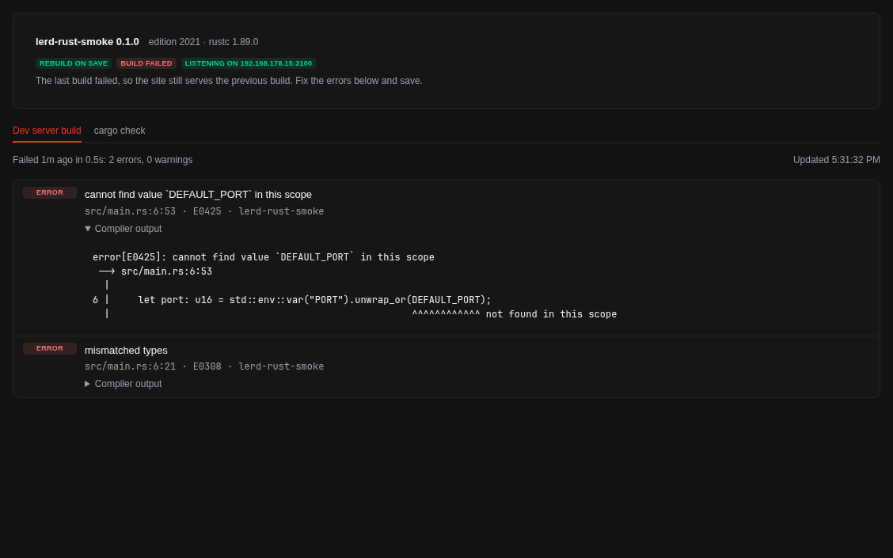

# Rust for Lerd

A [Lerd](https://lerd.sh) plugin for Rust web apps. Lerd already serves any dev server through its [host proxy](https://lerd.sh/usage/host-proxy); this plugin adds what a compiled language needs on top:

- **Rebuild on save.** `lerd rust:dev` is the site's dev command. It builds every change with cargo while the running app keeps serving, and swaps the app only when the build succeeds. A failed build leaves the previous one serving and says so.
- **A Rust tab** on every site with the last build, its errors and warnings with the compiler's full output, and an on-demand `cargo check`.
- **Cargo commands** in each site's Commands menu: check, test, clippy, fmt.
- **Tools for AI assistants**: `rust_status` and `rust_check` return compiler errors as data, with a skill that tells the assistant how a Rust site on Lerd behaves.
- **A HOST/PORT check.** The most common reason a Rust app is unreachable behind a proxy is a hardcoded `127.0.0.1:3000`. The dev server tells you when the app runs but nothing answers where Lerd proxies to.



It came out of [Rustyard](https://github.com/mtolhuys/rustyard), a small CLI that wraps the same workflow around Lerd. This plugin brings the parts that belong in Lerd itself to everyone who uses it, with nothing to install beyond `python3` and a Rust toolchain.

## Install

```bash
lerd plugin install rust                                   # from the catalog, once listed
lerd plugin install https://github.com/mtolhuys/lerd-rust  # or straight from this repository
```

Requires Lerd 1.38 or newer, `python3` 3.9 or newer, and cargo. Linux only for now (WSL included); macOS has not been tested yet.

## Use

In a Rust project:

```bash
lerd rust:setup   # sets proxy.command in .lerd.yaml to `lerd rust:dev`, after showing the change
lerd link         # Lerd shows the new command and asks you to approve it
```

Your app must listen on the `HOST` and `PORT` environment variables Lerd sets. [DOCS.md](DOCS.md) covers every command and option; it is also the plugin's Documentation tab in the dashboard.

## What it adds to Lerd

| Surface | |
|---|---|
| CLI commands | `lerd rust:dev`, `lerd rust:setup`, `lerd rust:status` |
| Site commands | Cargo check, Cargo test, Cargo clippy, Cargo fmt --check, Cargo fmt (asks first) |
| MCP tools and skill | `rust_status`, `rust_check`, and `SKILL.md` |
| API endpoints | `status` (GET), `project` (GET, loopback only), `check` (POST, loopback only) |
| Dashboard | A **Rust** tab on each site |
| Notifications | Only "Build failed", once per failure, and only if you allow them |

It adds no hooks, services, frameworks, pages on the rail or scripts on your sites' pages.

## What it reads, changes and sends

- **Reads**: the project's manifests through `cargo metadata --no-deps --offline`, the sizes and modification times of the project's files to notice saves, and `.lerd.yaml`. It never reads the contents of `.env`.
- **Runs**: cargo in the project (`build`, `run`, `check`, `test`, `clippy`, `fmt`, `metadata`, `locate-project`), as the dev command or when you choose a command. The site's own program runs with the environment `cargo run` gives it.
- **Changes**: `.lerd.yaml`, only through `lerd rust:setup` after you confirm, and only its `proxy.command` line (or a new file when there is none). `Cargo fmt` formats the code after asking. Each dev server's last build is kept as a small JSON file in the plugin's own data folder.
- **Network**: only Lerd's API on this machine, to list sites and to send the build-failed notification. The plugin never sends anything elsewhere. Cargo itself may download dependencies, as it does whenever you build.

## Development

```bash
python3 -m unittest discover -s tests -v
```

The tests run the dev server against real processes: a stand-in cargo covers process groups, swaps, failed builds and shutdown, and when cargo is installed a dependency-free Rust app checks real builds and compiler errors. To try a change in Lerd, `lerd plugin remove rust` (its data is kept) and `lerd plugin install .`.

Everything is plain Python from the standard library, so a reviewer can read all of it; there is nothing to build.

## License

MIT
